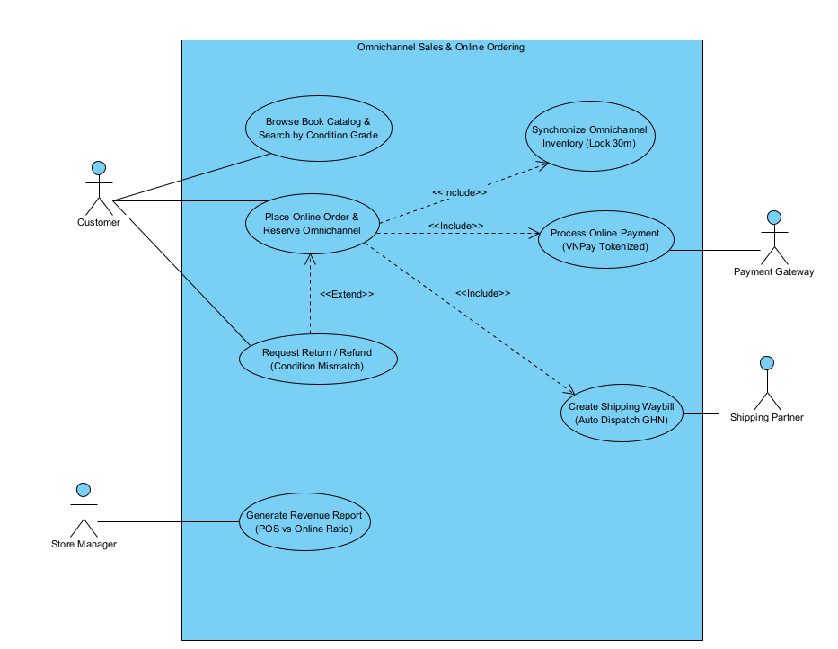
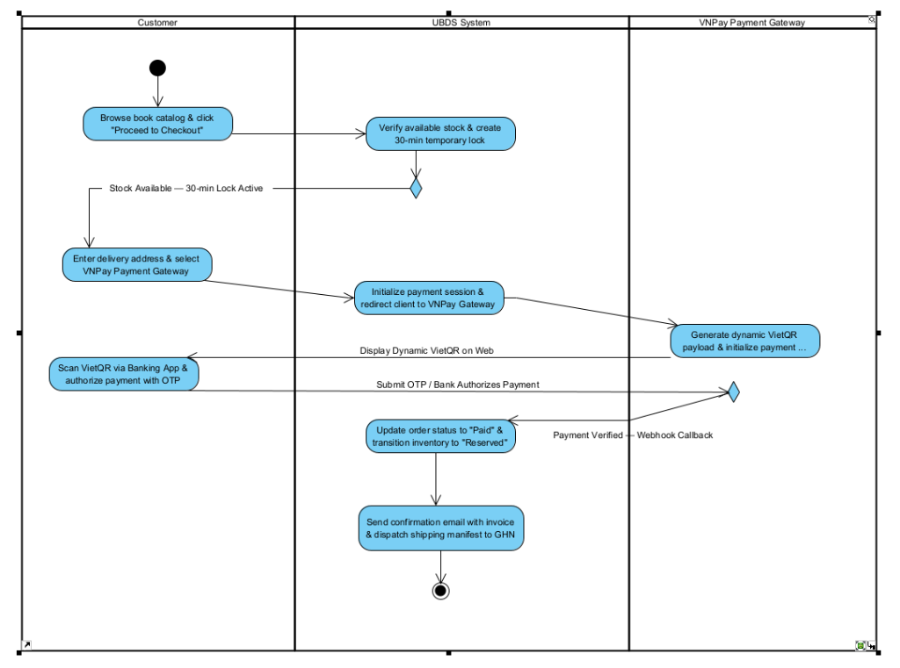
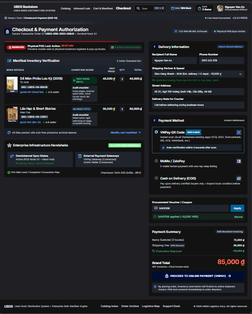
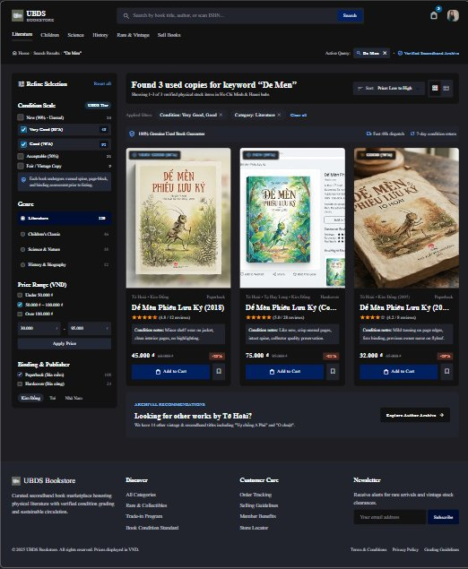

# FPT UNIVERSITY – DEPARTMENT OF SOFTWARE ENGINEERING
### COURSE: SWR302 – SOFTWARE REQUIREMENTS ENGINEERING | CLASS: SE20C02

# BÁO CÁO PHẦN C VÀ D.0 – HỆ THỐNG UBDS
## Used Book Distribution Standardization and Management System (UBDS)

**Author:** Nguyen Duc Thuan (Student ID: DE200568)  
**Supervising Lecturer:** Bich Tra  
**Assigned Scope:** Section C (Full 10 Core Groups & 28 Use Cases), Section D.0 (Visual Paradigm Project Architecture & Modeling Methodology), Personal Scope 13 – 15 (UCD-02, AD-02, Fully Dressed UC-13, UC-14, Wireframes SCR-13, SCR-14, and Summary UC-15)  
**Visual Paradigm Model File:** `02_Models/UBDS_Management_System.vpp`  
**Date:** November 2026

---

## 1. SECTION C – PROPOSED SYSTEM REQUIREMENTS FOR ANALYSIS

### 1.1 Analysis of 10 Mandatory Core Business Requirement Groups
To ensure comprehensive data coverage and robust business logic adhering to Karl Wiegers' requirements engineering standards, the following 10 requirement groups are established based on the omnichannel supply chain and used book distribution operations of UBDS:

| No. | Business Requirement Group | Detailed System Operations in UBDS Platform | Addressed Use Cases | Target Diagrams |
|:---:|:---|:---|:---:|:---:|
| 1 | **User Accounts & Role-Based Access Control (RBAC)** | Manages user profiles, consignment partner credentials, and granular permission enforcement for Warehouse Staff and POS Sales Staff. | UC-00a Register, UC-00b RBAC | UCD, ERD |
| 2 | **Used Book Catalog Browsing & Search** | Search books by ISBN, title, or author; multi-faceted filtering by 5-Tier Condition Scale (New, Very Good, Good, Acceptable, Poor), publisher, edition rarity, and price. | UC-14 Browse Catalog, UC-16 Search Condition | UCD, Wireframe (SCR-14) |
| 3 | **Core Business Transactions** | Used book intake inspection and cataloging (purchased & consigned books); in-store point-of-sale (POS) checkout; omnichannel online ordering and reservation. | UC-01 Intake, UC-07 Consign, UC-10 POS, UC-13 Online Order | UCD, AD Swimlane (AD-02), Wireframe (SCR-13) |
| 4 | **Multi-Party Workflow Coordination (≥ 3 Roles)** | Consignment workflow: Partner submits book → Warehouse Staff grades → Store Manager approves. Online fulfillment: Customer orders → Warehouse packs → GHN courier delivers. | UC-07 Consignment, UC-18 Fulfill Order | AD Swimlane (AD-01, AD-02) |
| 5 | **External System Integration** | Automated bibliographic metadata extraction via ISBN API; payment processing via VNPay / MoMo Gateway; real-time shipping waybill generation via GHN API. | UC-03 ISBN Fetch, UC-17 Online Payment, UC-19 GHN Waybill | Context Diagram, UCD (Secondary) |
| 6 | **Automated Notifications & Event Alerts** | Automated SMS/Email alerts to consignment partners upon item sale; instant alerts to Store Manager when staff overrides algorithm-suggested prices. | UC-21 Partner Alert, UC-22 Price Override Alert | SMD, Activity Diagram |
| 7 | **Master Data & Catalog Configuration** | Configuration of book genres, 5-Tier Condition grading criteria checklist, system-wide commission percentages, and inventory retention policies. | UC-23 Manage Checklist, UC-24 Set Commission | UCD, Business Rules |
| 8 | **Customer Feedback, Returns & Dispute Resolution** | Handles customer return requests due to physical condition mismatch between website description and actual book copy; dispute adjudication and refund processing. | UC-20 Request Return, UC-25 Resolve Dispute | UCD, SMD |
| 9 | **Financial Reporting & Business Intelligence** | Omnichannel revenue aggregation (POS in-store vs. Online web sales); consignment commission liability reports; inventory aging reports by condition tier. | UC-15 Revenue Report, UC-26 Consign Report | Context Diagram, Wireframe |
| 10 | **Time-Triggered Automated System Tasks (Cron/Scheduler)** | Automated release of online stock reservations expired past 30 minutes; month-end batch calculation of consignment partner commission payouts. | UC-27 Auto-Release Lock, UC-28 Month-End Settle | UCD (Scheduler), SMD |

---

### 1.2 Mandatory Quantitative Metrics & Measurable Performance KPIs

| No. | Quantitative Metric Parameter | Target Threshold | Engineering Rationale & System Justification |
|:---:|:---|:---:|:---|
| 1 | **Real-time Stock Lock Latency (Race Condition Prevention)** | $\le 0.5$ seconds (500 ms) | Guarantees zero double-selling collisions between in-store POS checkout and online website checkout for unique used book copies. |
| 2 | **Omnichannel Reservation Hold Duration** | 30 minutes ($\pm 10$s) | Provides adequate time for online buyers to complete payment while releasing abandoned items back to physical store shelves. |
| 3 | **5-Tier Condition Grading Accuracy** | $\ge 95\%$ audit compliance | Standardizes physical assessment across intake staff, keeping condition mismatch dispute rates below 2%. |
| 4 | **Automated ISBN Metadata Retrieval Speed** | $\le 2.0$ seconds / query | Eliminates 70% of manual catalog entry labor during bulk used book lot intake. |
| 5 | **Online Order Fulfillment Processing Time** | $\le 24$ hours from payment | Enforces strict SLA for warehouse picking, packing, and courier handover (GHN API). |
| 6 | **Payment Gateway Webhook Callback Latency** | $\le 3.0$ seconds | Instantly transitions online orders to "Paid" and prevents user abandonment on VNPay QR checkout. |
| 7 | **System High-Availability Uptime** | $\ge 99.5\%$ uptime | Maintains uninterrupted retail operations across store POS nodes and public web catalog during peak hours. |

---

### 1.3 Comprehensive Catalog of 28 System Use Cases

| Package ID & Name | Use Case ID & Name | Primary Actor | Key Relationships |
|:---|:---|:---:|:---|
| **Package 1:**<br>Inventory Intake & 5-Tier Grading | UC-01 Register New Inventory Item<br>UC-02 Scan ISBN Barcode<br>UC-03 Fetch ISBN Metadata<br>UC-04 Manual Metadata Override<br>UC-05 Assess Book Condition (5 Tiers)<br>UC-06 Attach Defect Photos<br>UC-07 Receive Consignment Book<br>UC-08 Calculate Dynamic Price<br>UC-09 Override Suggested Price | Warehouse Staff<br>Warehouse Staff<br>Warehouse Staff<br>Warehouse Staff<br>Warehouse Staff<br>Warehouse Staff<br>Consignment Partner<br>Warehouse Staff<br>Warehouse Staff | Include UC-02, UC-03, UC-05, UC-08<br>Include in UC-01<br>Include in UC-01<br>Extend UC-03<br>Include in UC-01<br>Extend UC-05<br>Primary Consignment<br>Include in UC-01<br>Extend UC-08 |
| **Package 2:**<br>Omnichannel Sales & Stock Reservation<br>*(Scope: Nguyen Duc Thuan)* | UC-10 Process POS Sale Transaction<br>UC-11 Synchronize Omnichannel Inventory (Lock 30m)<br>UC-12 Apply Member Loyalty Discount<br>UC-13 Place Online Order & Reserve Omnichannel<br>UC-14 Browse Book Catalog & 5-Tier Search<br>UC-15 Generate Revenue Report (POS vs Online)<br>UC-16 Filter Catalog by 5-Tier Condition<br>UC-17 Process Online Payment (VNPay)<br>UC-18 Pick & Pack Online Order<br>UC-19 Create Shipping Waybill (GHN API)<br>UC-20 Request Return/Refund (Condition Mismatch) | Sales Staff<br>System Platform<br>Sales Staff<br>Customer<br>Customer<br>Store Manager<br>Customer<br>Payment Gateway<br>Warehouse Staff<br>Shipping Partner<br>Customer | Include UC-11<br>Include in UC-10, UC-13<br>Extend UC-10<br>Include UC-11, UC-17, UC-19<br>Primary Catalog Search<br>Store Analytics<br>Secondary in UC-14<br>Include in UC-13<br>Post-order fulfillment<br>Include in UC-13<br>Extend UC-13 |
| **Package 3:**<br>Consignment & Dispute Resolution | UC-21 Notify Partner on Book Sold<br>UC-22 Alert Manager on Price Override<br>UC-23 Manage Inspection Checklist<br>UC-24 Configure Commission Rates<br>UC-25 Resolve Condition Dispute<br>UC-26 Generate Consignment Settlement | Email Service<br>Store Manager<br>Store Manager<br>Store Manager<br>Store Manager<br>Store Manager | System notification<br>Security Alert<br>Master Data Admin<br>Financial Policy<br>Customer Support<br>Monthly accounting |
| **Package 4:**<br>System Automation & Maintenance | UC-27 Auto-Release Expired Reservations (30m)<br>UC-28 Month-End Settlement Scheduler | System Scheduler<br>System Scheduler | Automated Cron Job<br>Automated Cron Job |

---

### 1.4 Requirements Elicitation Interview Questions
1. **Inventory Collision Rule:** When an in-store POS cashier scans a unique physical book at the exact millisecond an online buyer submits checkout on the website, which transaction holds priority, and how is the loser notified?
2. **Revenue Channel Reporting:** What exact granularity and metrics must the end-of-day revenue report provide to distinguish between physical POS cashflow and online payment gateway settlements?

---

## 2. SECTION D.0 – VISUAL PARADIGM ARCHITECTURAL MODELING FRAMEWORK

### 2.1 Standard Model Explorer Directory Architecture (`UBDS_Management_System.vpp`)
All system models and engineering diagrams are unified within a single repository project `UBDS_Management_System.vpp` stored in the `02_Models/` directory:

```text
UBDS_Management_System
├── 01 Context
│   └── CD-01 Context Diagram (System DFD Context)
├── 02 Use Case Model
│   ├── UCD-01 System Overview Diagram
│   ├── Package 1 - Inventory Intake & Grading
│   ├── Package 2 - Omnichannel Sales & Stock Reservation (Nguyen Duc Thuan)
│   ├── Package 3 - Consignment & Disputes
│   └── Package 4 - Admin & Automation
├── 03 Wireframes
│   ├── SCR-13 Place Online Order & Checkout (Nguyen Duc Thuan)
│   ├── SCR-14 Browse & Search Book Catalog (Nguyen Duc Thuan)
│   ├── SCR-01 Register New Inventory Item
│   ├── SCR-05 Assess Book Condition
│   └── SCR-10 Process POS Sale Transaction
├── 04 Activity Diagrams (Swimlane)
│   ├── AD-01 Book Intake & Condition Assessment Process
│   ├── AD-02 Omnichannel Order & Stock Reservation Process (Nguyen Duc Thuan)
│   └── AD-03 Online Order Fulfillment & GHN Process
└── 05 State Machine Diagrams
    ├── SMD-01 Book Inventory Item Lifecycle
    └── SMD-02 Online Order Fulfillment Lifecycle
```

### 2.2 Three-Step Analysis & Verification Framework
Following strict academic engineering guidelines ("Every diagram must include an analytical breakdown and a verified result image"), every diagram adheres to a rigorous 3-step analysis framework:
- **Step 1: Purpose & System Boundary Analysis:** Defines the operational context, participants, and architectural boundaries of the workflow or package.
- **Step 2: Element & Relationship Specification Table:** Provides an itemized table detailing actors, include/extend relationships, decision guards, and data flows.
- **Step 3: Verified Visual Paradigm Graphical Export:** Embeds high-resolution visual exports ($\ge 150$ dpi) from Visual Paradigm with official numbering and descriptive captions.

### 2.3 Domain Business Glossary

| Term / Acronym | Formal Engineering Definition in UBDS Platform |
|:---|:---|
| **Unique Inventory Item** | Each physical used book copy is tracked as an individual, non-fungible inventory record with its own barcode/SKU, physical condition tier, and shelf location. |
| **5-Tier Condition Scale** | Industry-standard grading hierarchy: New (99%), Very Good (85%), Good (70%), Acceptable (50%), and Poor/Fair (<40%). Directly determines selling price. |
| **Omnichannel Stock Lock** | Real-time database lock activated for 30 minutes when an online buyer initiates checkout, preventing in-store POS cashiers from selling the copy simultaneously. |
| **Consignment Settlement** | Automated reconciliation and payout calculation for consignment partners after deduction of platform commission fees upon successful item sale. |
| **Condition Dispute** | Post-sale customer complaint filed within 7 days if the physical copy received deviates materially from the published 5-tier condition checklist description. |

---

## 3. TECHNICAL DELIVERABLES – SCOPE 13 TO 15 (NGUYEN DUC THUAN)

This section presents the primary individual engineering deliverables authored by **Nguyen Duc Thuan (Student ID: DE200568)**, encompassing Package 2: Omnichannel Sales & Stock Reservation, Fully Dressed Use Cases (UC-13 & UC-14), High-Fidelity UI Wireframes (SCR-13 & SCR-14), and Revenue Reporting (UC-15).

### 3.1 Package 2 Use Case Diagram – Omnichannel Sales & Online Ordering (UCD-02)

#### 3.1.1 Analytical Breakdown & Structural Element Mapping
- **Step 1 (Purpose & Boundary):** UCD-02 models the interactions between human actors, backend inventory systems, and third-party gateways during online ordering, inventory synchronization, and return requests.
- **Step 2 (Element Specification Table):**

| Diagram Element Type | Participating Element Name | Architectural Role & Description |
|:---|:---|:---|
| Primary Human Actor | Customer | Browses catalog, places online orders, and submits return/refund requests. |
| Primary Human Actor | Store Manager | Monitors omnichannel inventory health and reviews revenue split analytics. |
| Secondary External System | Payment Gateway (VNPay) | Third-party financial partner processing tokenized VietQR online transactions. |
| Secondary External System | Shipping Partner (GHN) | Third-party logistics API generating real-time tracking waybills. |
| Central Core Use Case | UC-13 Place Online Order & Reserve Omnichannel | Core transaction orchestrating stock reservation, payment authorization, and shipment dispatch. |
| Mandatory «Include» | UC-11 Synchronize Omnichannel Inventory | Activated by UC-13 to establish immediate 30-min stock lock on unique physical item. |
| Mandatory «Include» | UC-17 Process Online Payment | Activated by UC-13 to tokenize payment transaction via VNPay gateway. |
| Mandatory «Include» | UC-19 Create Shipping Waybill | Activated by UC-13 upon payment success to automatically register parcel with GHN. |
| Optional «Extend» | UC-20 Request Return / Refund | Triggered optionally by Customer within 7 days if condition mismatch is detected. |

#### 3.1.2 Verified Visual Paradigm Export (UCD-02)


*Figure 1: Package 2 Use Case Diagram – Omnichannel Sales & Online Ordering (UCD-02 in Visual Paradigm)*

---

### 3.2 Swimlane Activity Diagram – Online Order & Omnichannel Stock Lock (AD-02)

#### 3.2.1 Workflow Analysis & Architectural Decomposition
- **Step 1 (Purpose & Boundary):** AD-02 details the end-to-end procedural execution of UC-13 across 3 distinct swimlane partitions: Customer (Client), UBDS Core Platform (Backend Engine), and VNPay Payment Gateway (External Service). The workflow enforces a strict sequential waterfall layout without crossing lines, integrating real-time 30-minute stock locks to eliminate double-selling race conditions with physical retail POS cashiers.
- **Step 2 (Swimlane Element Mapping Table):**

| Swimlane Partition | Action Node / Decision Guard | Operational Behavior & Logic |
|:---|:---|:---|
| Customer | 1. Browse catalog & click "Proceed to Checkout" | User initiates cart checkout from web UI (SCR-13). |
| UBDS Core Platform | 2. Verify available stock & create 30-min lock | Queries DB for item status "Available"; creates atomic lock. |
| UBDS Core Platform | Decision: [Stock Available — 30-min Lock Active] | If available, locks copy and proceeds; if sold, aborts. |
| Customer | 3. Enter delivery address & select VNPay Gateway | Customer inputs shipping address and picks VNPay QR. |
| UBDS Core Platform | 4. Initialize payment session & redirect to VNPay | Creates transaction payload and connects to VNPay API. |
| VNPay Payment Gateway | 5. Generate dynamic VietQR payload & await scan | Produces dynamic VietQR code and serves checkout page. |
| Customer | 6. Scan VietQR via Banking App & authorize OTP | Customer scans VietQR with mobile banking app and enters OTP. |
| VNPay Payment Gateway | Decision: [Payment Verified — Webhook Callback] | VNPay authenticates fund transfer and fires webhook to UBDS. |
| UBDS Core Platform | 7. Update order to "Paid" & lock stock "Reserved" | Converts order to "Paid" and locks book SKU as "Reserved". |
| UBDS Core Platform | 8. Send confirmation email & dispatch waybill to GHN | Emits customer invoice email and triggers GHN API waybill. |

#### 3.2.2 Verified Visual Paradigm Export (AD-02)


*Figure 2: Swimlane Activity Diagram – Online Order & Omnichannel Stock Lock Process (AD-02 in Visual Paradigm)*

---

### 3.3 Fully Dressed Use Case Specification: UC-13 (Place Online Order & Reserve Omnichannel)

| Specification Field | Detailed Specification Content |
|:---|:---|
| **Use Case ID & Name** | UC-13: Place Online Order & Reserve Omnichannel |
| **Author & Date** | Nguyen Duc Thuan (DE200568) \| November 2026 |
| **Primary Actor** | Online Customer |
| **Secondary Actors** | Payment Gateway (VNPay API), Shipping Partner (GHN API), Email Service |
| **Trigger** | Customer clicks "Proceed to Checkout" from online shopping cart. |
| **Preconditions** | PRE-1: Customer has selected at least one unique book copy with status "Available".<br>PRE-2: Online payment gateway and shipping APIs are operational. |
| **Postconditions** | POST-1: New order record created with status "Paid - Processing" (VNPay) or "Pending Confirmation" (COD).<br>POST-2: Physical book status transitions from "Available" to "Reserved", instantly locking in-store POS checkout (UC-11).<br>POST-3: Confirmation email containing tracking waybill is automatically dispatched to Customer. |
| **Normal Flow<br>(Main Success Scenario)** | 1. Customer inspects used book items in cart (title, 5-tier condition badge, price).<br>2. Customer inputs recipient delivery details: full name, phone number, destination address.<br>3. System calls GHN API to calculate exact shipping fee based on warehouse distance.<br>4. Customer inputs voucher coupon (if applicable) and selects payment method: VNPay VietQR or COD.<br>5. Customer clicks "Proceed to Online Payment (VNPay)".<br>6. System activates 30-minute Omnichannel Stock Lock (UC-11 Synchronize Omnichannel Inventory).<br>7. Customer completes biometric/OTP authentication on VNPay banking app (UC-17 Process Online Payment).<br>8. System receives webhook callback confirming successful payment, updating order to "Paid - Processing".<br>9. System triggers automated order packaging notice for warehouse (UC-18) and issues invoice email. |
| **Alternative Flows<br>(Branching Logic)** | 4.1 Customer selects Cash on Delivery (COD): Bypasses online payment step 7; order saved as "Pending Confirmation" and proceeds directly to step 9.<br>6.1 Physical POS Race Condition: If in-store POS cashier completed sale of the copy seconds earlier, system detects status "Sold", prompts apology message, removes item from cart, and recalculates total before processing payment. |
| **Exceptions<br>(Error Handling)** | 7.E1 Payment failure or customer cancellation: System maintains order in "Payment Failed" state for 30 minutes. If unpaid upon timer expiration, Scheduler automatically releases stock lock (UC-27 Auto-Release Expired Reservations). |
| **Non-Functional Requirements** | NFR-01: Stock reservation lock latency must execute within $\le 500$ ms.<br>NFR-02: Payment transaction pipe must comply with PCI-DSS Level 1 standards. |
| **Business Rules** | BR-05: Every used book is a unique physical item; only one active reservation can exist at any given timestamp.<br>BR-06: Online cart reservation holds a maximum duration of 30 minutes. |

---

### 3.4 User Interface Wireframe: SCR-13 (Place Online Order & Checkout)


*Figure 3: High-Fidelity UI Wireframe SCR-13 – Checkout & Omnichannel Stock Lock (Google Stitch Dark-Mode)*

#### 3.4.1 Detailed UI Control Specification Table (SCR-13)

| Control ID | Control Name | UI Component Type | Event Handling & Business Logic |
|:---:|:---|:---:|:---|
| **CTR-13.1** | Stock Lock Timer | Live Countdown Badge | Displays remaining reservation time (starts at 24:27 / 30:00). Turns red when < 5 mins; triggers auto-release at 00:00. |
| **CTR-13.2** | Inventory Item Card | Card Container | Renders book title, SKU, shelf location (HN-W1), verified condition badge (Very Good 85%), and audit checklist breakdown. |
| **CTR-13.3** | Delivery Form | Input Fields | Captures recipient Full Name, Phone Number, and Street Address with live validation. |
| **CTR-13.4** | Shipping Selector | Dropdown Select | Connects to GHN API; calculates fee dynamically (GHN Standard: 20,000 VND). |
| **CTR-13.5** | Payment Method | Radio Group | Options: VNPay QR Code (Default), MoMo/ZaloPay, and Cash on Delivery (COD). |
| **CTR-13.6** | Voucher Input | Text Field + Button | Validates promotional discount codes (e.g. SAVE10K: -10,000 VND) and recalculates Grand Total. |
| **CTR-13.7** | Proceed CTA Button | Primary Action Button | Calls VNPay API, establishes omnichannel reservation, and redirects user to secure payment gateway. |

---

### 3.5 Fully Dressed Use Case Specification: UC-14 (Browse Book Catalog & Search by Condition Grade)

| Specification Field | Detailed Specification Content |
|:---|:---|
| **Use Case ID & Name** | UC-14: Browse Book Catalog & Search by Condition Grade |
| **Author & Date** | Nguyen Duc Thuan (DE200568) \| November 2026 |
| **Primary Actor** | Online Customer / Visitor |
| **Secondary Actors** | Inventory Database Service |
| **Trigger** | User enters search keywords or navigates to catalog directory. |
| **Preconditions** | PRE-1: System database is operational and indexing active used book catalog. |
| **Postconditions** | POST-1: System renders matched used book copies with certified 5-tier condition badges, prices, and actual inspection photos. |
| **Normal Flow<br>(Main Success Scenario)** | 1. User enters keywords (title, author, or ISBN) into search bar.<br>2. User filters criteria on left sidebar: 5-Tier Condition Scale checkboxes (New, Very Good, Good, Acceptable, Poor), Genre, and Price Range.<br>3. User clicks "Apply Filters" or selects sorting options (Price Low-to-High, Condition High-to-Low).<br>4. System queries active inventory database and returns filtered result cards.<br>5. System displays matching items with title, author, condition badge, discounted price versus original retail price, and verified inspection photos.<br>6. Customer clicks "Quick View Photos" to inspect actual spine/page wear or clicks "Add to Cart" (initiating UC-13). |
| **Alternative Flows<br>(Branching Logic)** | 4.1 No matching items found: System displays notice "No used copies match selected filters", recommending similar titles in same genre or author archive. |
| **Exceptions<br>(Error Handling)** | 1.E1 Query contains malicious injection characters: System automatically sanitizes input against SQL injection vulnerabilities before dispatching database query. |
| **Business Rules** | BR-07: Every listed book copy must display an official 5-Tier Condition Scale badge.<br>BR-08: Catalog only displays copies with status "Available" (omits "Reserved" or "Sold" copies). |

---

### 3.6 User Interface Wireframe: SCR-14 (Browse Book Catalog & 5-Tier Filter)


*Figure 4: High-Fidelity UI Wireframe SCR-14 – Catalog & 5-Tier Condition Filter (Google Stitch Dark-Mode)*

#### 3.6.1 Detailed UI Control Specification Table (SCR-14)

| Control ID | Control Name | UI Component Type | Event Handling & Business Logic |
|:---:|:---|:---:|:---|
| **CTR-14.1** | Global Search Bar | Text Search Input | Executes debounced auto-complete search by title, author, or ISBN barcode. |
| **CTR-14.2** | 5-Tier Condition Filter | Checkbox Multi-Select | Allows multi-selection of condition grades: New (99%), Very Good (85%), Good (70%), Acceptable (50%), and Poor (<40%). |
| **CTR-14.3** | Genre & Category Filter | Sidebar List | Filters items by category (Literature, Children, Science, History, Rare & Vintage). |
| **CTR-14.4** | Price Range Slider | Dual-Handle Slider | Filters catalog items within specified VND range (e.g. 30,000 - 95,000 VND). |
| **CTR-14.5** | Book Item Card | Card Container | Displays real cover photo, publication year, certified condition badge, audit notes, selling price, and discount percentage. |
| **CTR-14.6** | Add to Cart Button | Primary Action Button | Adds selected unique physical book copy to cart and prompts user to proceed to checkout (SCR-13). |
| **CTR-14.7** | Save to Wishlist | Icon Button | Saves unique out-of-stock items for restock alerts when new lots arrive. |

---

### 3.7 Summary Specification: UC-15 (Generate Revenue Report)

| Attribute Field | Specification Details |
|:---|:---|
| **Use Case ID & Title** | UC-15: Generate Revenue Report (POS vs. Online Ratio) |
| **Primary Actor** | Store Manager |
| **Operational Goal** | Aggregates sales metrics across in-store POS cash registers and online web orders, computing gross revenue, net margin, and consignment commission liabilities. |
| **System Inputs** | Date range selector (Daily, Weekly, Monthly), store location filter (Hanoi Hub, HCMC Hub), sales channel toggle (POS, Online, Omnichannel All). |
| **Processing Logic** | 1. Queries completed transactions with status "Paid".<br>2. Splits cashflow between in-store POS and VNPay online gateway.<br>3. Automatically calculates commission deductions for consigned books.<br>4. Generates comparative ratio visualization. |
| **System Outputs** | Interactive dashboard chart displaying revenue trends, breakdown matrix, and exportable financial spreadsheet (XLSX/PDF). |

---

## 4. SUBMISSION & REPOSITORY STRUCTURE GUIDELINES (GITHUB)

To ensure compliance with university submission requirements, the GitHub repository is structured cleanly with all necessary modeling artifacts and specification documents:
- `README.md` (Root Directory): Repository landing page presenting project overview, author details (Nguyen Duc Thuan – DE200568), class SE20C02, and grading instructions.
- `.gitignore` (Root Directory): Strictly ignores build artifacts, node_modules/, Word temp lock files (`~$*.docx`), and log files.
- `BaoCao_PhanC_D0_UBDS_SE20C02_Thuan_English.docx`: Official Microsoft Word report formatted to Times New Roman 13pt, Justified alignment, 1.3 line spacing, 3.0 cm left margin.
- `BaoCao_PhanC_D0_UBDS_SE20C02_Thuan_English.md`: Full Markdown edition readable directly in GitHub browser interface.
- `02_Models/UBDS_Management_System.vpp`: Primary Visual Paradigm project file containing all standardized UML models (mandatory submission artifact).
- `03_Images/`: High-resolution PNG diagram exports (UCD-02, AD-02) and Google Stitch dark-mode wireframes (UI_SCR-13, UI_SCR-14).
