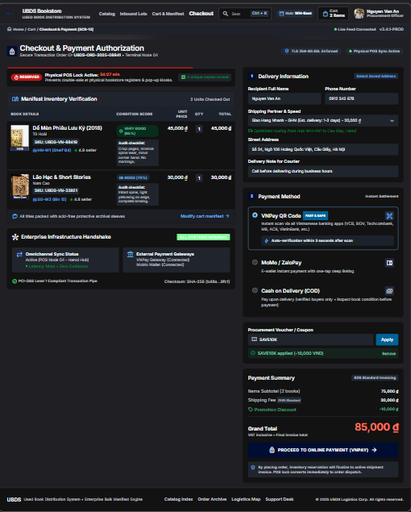
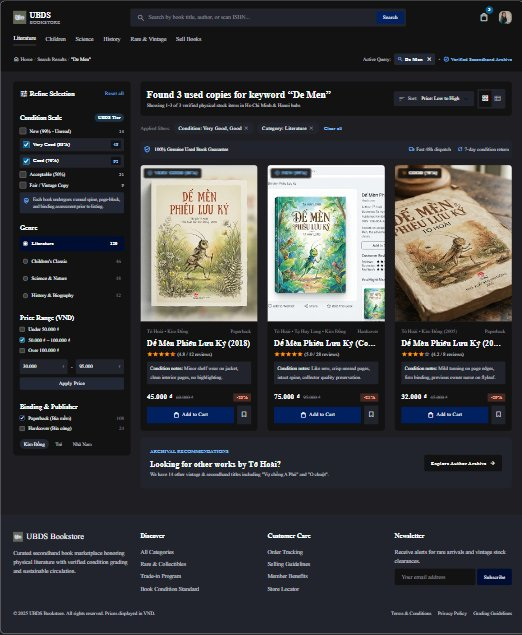

# FPT UNIVERSITY – DEPARTMENT OF SOFTWARE ENGINEERING
### COURSE: SWR302 – SOFTWARE REQUIREMENTS ENGINEERING | CLASS: SE20C02

# ĐẶC TẢ USE CASE – HỆ THỐNG UBDS
## Package 2: Omnichannel Sales & Stock Reservation (Scope: UC-13, UC-14, UC-15)

**Target Platform:** Used Book Distribution Standardization and Management System (UBDS)  
**Author:** Nguyen Duc Thuan (Student ID: DE200568)  
**Supervising Lecturer:** Bich Tra  
**Assigned Scope:** Deliverables 13 – 15: Fully Dressed UC-13, UC-14, Wireframes SCR-13, SCR-14, and Summary UC-15  
**Specification Standards:** Alistair Cockburn Template & Karl Wiegers Requirements Engineering Standards  
**Date:** November 2026  

---

## 1. FULLY DRESSED USE CASE SPECIFICATION: UC-13

This specification defines the complete functional and operational logic for online ordering, omnichannel stock locking, and electronic payment processing.

| Specification Field | Detailed Specification Content |
|:---|:---|
| **Use Case ID & Name** | UC-13: Place Online Order & Reserve Omnichannel |
| **Author & Date** | Nguyen Duc Thuan (DE200568) \| November 2026 |
| **Primary Actor** | Online Customer |
| **Secondary Actors** | Payment Gateway (VNPay API), Shipping Partner (GHN API), Email Service |
| **Trigger** | Customer clicks "Proceed to Checkout" from online shopping cart. |
| **Preconditions** | PRE-1: Customer has selected at least one unique book copy with status "Available". PRE-2: Online payment gateway and shipping APIs are operational. |
| **Postconditions** | POST-1: New order record created with status "Paid - Processing" (VNPay) or "Pending Confirmation" (COD). POST-2: Physical book status transitions from "Available" to "Reserved", instantly locking in-store POS checkout (UC-11). POST-3: Confirmation email containing tracking waybill is automatically dispatched to Customer. |
| **Normal Flow (Main Success Scenario)** | 1. Customer inspects used book items in cart (title, 5-tier condition badge, price). 2. Customer inputs recipient delivery details: full name, phone number, destination address. 3. System calls GHN API to calculate exact shipping fee based on warehouse distance. 4. Customer inputs voucher coupon (if applicable) and selects payment method: VNPay VietQR or COD. 5. Customer clicks "Proceed to Online Payment (VNPay)". 6. System activates 30-minute Omnichannel Stock Lock (UC-11 Synchronize Omnichannel Inventory). 7. Customer completes biometric/OTP authentication on VNPay banking app (UC-17 Process Online Payment). 8. System receives webhook callback confirming successful payment, updating order to "Paid - Processing". 9. System triggers automated order packaging notice for warehouse (UC-18) and issues invoice email. |
| **Alternative Flows (Branching Logic)** | 4.1 Customer selects Cash on Delivery (COD): Bypasses online payment step 7; order saved as "Pending Confirmation" and proceeds directly to step 9. 6.1 Physical POS Race Condition: If in-store POS cashier completed sale of the copy seconds earlier, system detects status "Sold", prompts apology message, removes item from cart, and recalculates total before processing payment. |
| **Exceptions (Error Handling)** | 7.E1 Payment failure or customer cancellation: System maintains order in "Payment Failed" state for 30 minutes. If unpaid upon timer expiration, Scheduler automatically releases stock lock (UC-27 Auto-Release Expired Reservations). |
| **Non-Functional Requirements** | NFR-01: Stock reservation lock latency must execute within $\le 500$ ms. NFR-02: Payment transaction pipe must comply with PCI-DSS Level 1 standards. |
| **Business Rules** | BR-05: Every used book is a unique physical item; only one active reservation can exist at any given timestamp. BR-06: Online cart reservation holds a maximum duration of 30 minutes. |

---

## 2. USER INTERFACE WIREFRAME: SCR-13 (CHECKOUT & RESERVATION)

High-fidelity dark-mode UI wireframe designed in Google Stitch, illustrating the complete checkout flow with live omnichannel reservation timers:

*Figure 1: High-Fidelity UI Wireframe SCR-13 – Checkout & Omnichannel Stock Lock (Google Stitch Dark-Mode)*

### 2.1 Detailed UI Control Specification Table (SCR-13)

| Control ID | Control Name | UI Component Type | Event Handling & Business Logic |
|:---:|:---|:---:|:---|
| **CTR-13.1** | Stock Lock Timer | Live Countdown Badge | Displays remaining reservation time (starts at 24:27 / 30:00). Turns red when < 5 mins; triggers auto-release at 00:00. |
| **CTR-13.2** | Inventory Item Card | Card Container | Renders book title, SKU, shelf location (HN-W1), verified condition badge (Very Good 85%), and audit checklist breakdown. |
| **CTR-13.3** | Delivery Form | Input Fields | Captures recipient Full Name, Phone Number, and Street Address with live validation. |
| **CTR-13.4** | Shipping Selector | Dropdown Select | Connects to GHN API; calculates fee dynamically (GHN Standard: 20,000 VND). |
| **CTR-13.5** | Payment Method | Radio Group | Options: VNPay QR Code (Default), MoMo/ZaloPay, and Cash on Delivery (COD). |
| **CTR-13.6** | Voucher Input | Text Field + Button | Validates promotional discount codes (e.g. SAVE10K: -10,000 VND) and recalculates Grand Total. |
| **CTR-13.7** | Proceed CTA Button | Primary Action Button | Calls VNPay API, establishes omnichannel reservation, and redirects user to secure payment gateway. |

---

## 3. FULLY DRESSED USE CASE SPECIFICATION: UC-14

This specification details catalog search capabilities, keyword matching, and multi-faceted filtering based on the standardized 5-Tier Condition Scale.

| Specification Field | Detailed Specification Content |
|:---|:---|
| **Use Case ID & Name** | UC-14: Browse Book Catalog & Search by Condition Grade |
| **Author & Date** | Nguyen Duc Thuan (DE200568) \| November 2026 |
| **Primary Actor** | Online Customer / Visitor |
| **Secondary Actors** | Inventory Database Service |
| **Trigger** | User enters search keywords or navigates to catalog directory. |
| **Preconditions** | PRE-1: System database is operational and indexing active used book catalog. |
| **Postconditions** | POST-1: System renders matched used book copies with certified 5-tier condition badges, prices, and actual inspection photos. |
| **Normal Flow (Main Success Scenario)** | 1. User enters keywords (title, author, or ISBN) into search bar. 2. User filters criteria on left sidebar: 5-Tier Condition Scale checkboxes (New, Very Good, Good, Acceptable, Poor), Genre, and Price Range. 3. User clicks "Apply Filters" or selects sorting options (Price Low-to-High, Condition High-to-Low). 4. System queries active inventory database and returns filtered result cards. 5. System displays matching items with title, author, condition badge, discounted price versus original retail price, and verified inspection photos. 6. Customer clicks "Quick View Photos" to inspect actual spine/page wear or clicks "Add to Cart" (initiating UC-13). |
| **Alternative Flows (Branching Logic)** | 4.1 No matching items found: System displays notice "No used copies match selected filters", recommending similar titles in same genre or author archive. |
| **Exceptions (Error Handling)** | 1.E1 Query contains malicious injection characters: System automatically sanitizes input against SQL injection vulnerabilities before dispatching database query. |
| **Business Rules** | BR-07: Every listed book copy must display an official 5-Tier Condition Scale badge. BR-08: Catalog only displays copies with status "Available" (omits "Reserved" or "Sold" copies). |

---

## 4. USER INTERFACE WIREFRAME: SCR-14 (CATALOG & 5-TIER FILTER)

High-fidelity dark-mode UI wireframe designed in Google Stitch, illustrating multi-faceted searching and certified used book condition indicators:

*Figure 2: High-Fidelity UI Wireframe SCR-14 – Catalog & 5-Tier Condition Filter (Google Stitch Dark-Mode)*

### 4.1 Detailed UI Control Specification Table (SCR-14)

| Control ID | Control Name | UI Component Type | Event Handling & Business Logic |
|:---:|:---|:---:|:---|
| **CTR-14.1** | Global Search Bar | Text Search Input | Executes debounced auto-complete search by title, author, or ISBN barcode. |
| **CTR-14.2** | 5-Tier Condition Filter | Checkbox Multi-Select | Allows multi-selection of condition grades: New (99%), Very Good (85%), Good (70%), Acceptable (50%), and Poor (<40%). |
| **CTR-14.3** | Genre & Category Filter | Sidebar List | Filters items by category (Literature, Children, Science, History, Rare & Vintage). |
| **CTR-14.4** | Price Range Slider | Dual-Handle Slider | Filters catalog items within specified VND range (e.g. 30,000 - 95,000 VND). |
| **CTR-14.5** | Book Item Card | Card Container | Displays real cover photo, publication year, certified condition badge, audit notes, selling price, and discount percentage. |
| **CTR-14.6** | Add to Cart Button | Primary Action Button | Adds selected unique physical book copy to cart and prompts user to proceed to checkout (SCR-13). |
| **CTR-14.7** | Save to Wishlist | Icon Button | Saves unique out-of-stock items for restock alerts when new lots arrive. |

---

## 5. SUMMARY SPECIFICATION: UC-15 (GENERATE REVENUE REPORT)

Analytical summary specification for store management analytics and omnichannel revenue reporting:

| Attribute Field | Specification Details |
|:---|:---|
| **Use Case ID & Title** | UC-15: Generate Revenue Report (POS vs. Online Ratio) |
| **Primary Actor** | Store Manager |
| **Operational Goal** | Aggregates sales metrics across in-store POS cash registers and online web orders, computing gross revenue, net margin, and consignment commission liabilities. |
| **System Inputs** | Date range selector (Daily, Weekly, Monthly), store location filter (Hanoi Hub, HCMC Hub), sales channel toggle (POS, Online, Omnichannel All). |
| **Processing Logic** | 1. Queries completed transactions with status "Paid". 2. Splits cashflow between in-store POS and VNPay online gateway. 3. Automatically calculates commission deductions for consigned books. 4. Generates comparative ratio visualization. |
| **System Outputs** | Interactive dashboard chart displaying revenue trends, breakdown matrix, and exportable financial spreadsheet (XLSX/PDF). |
